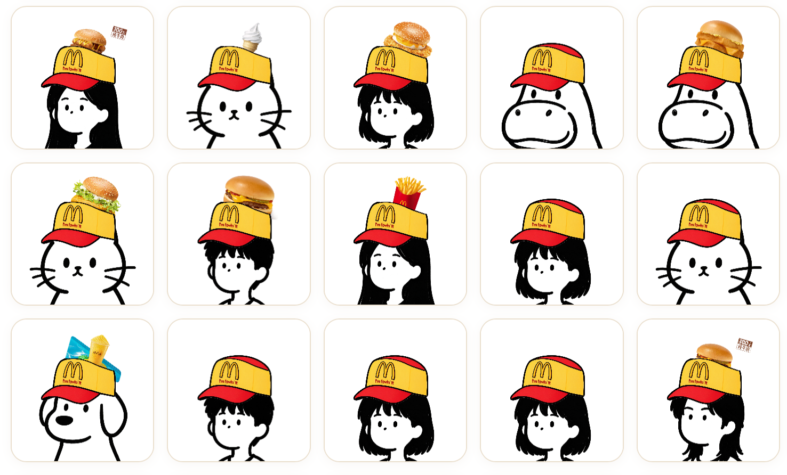
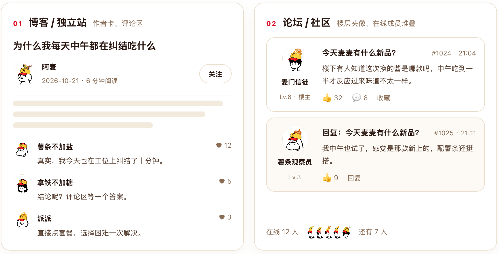
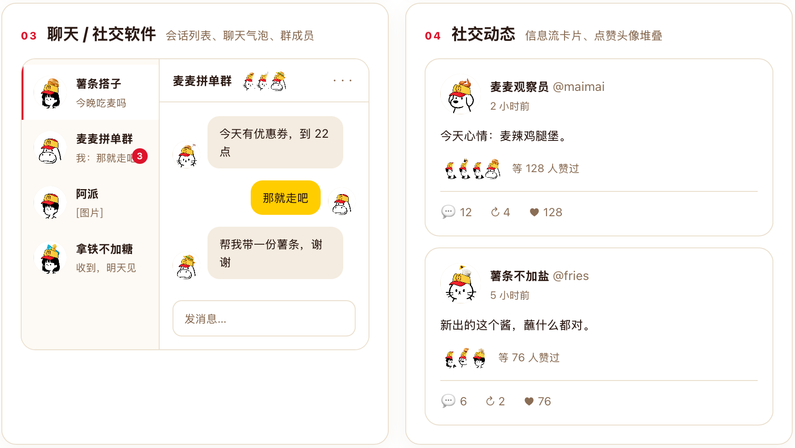
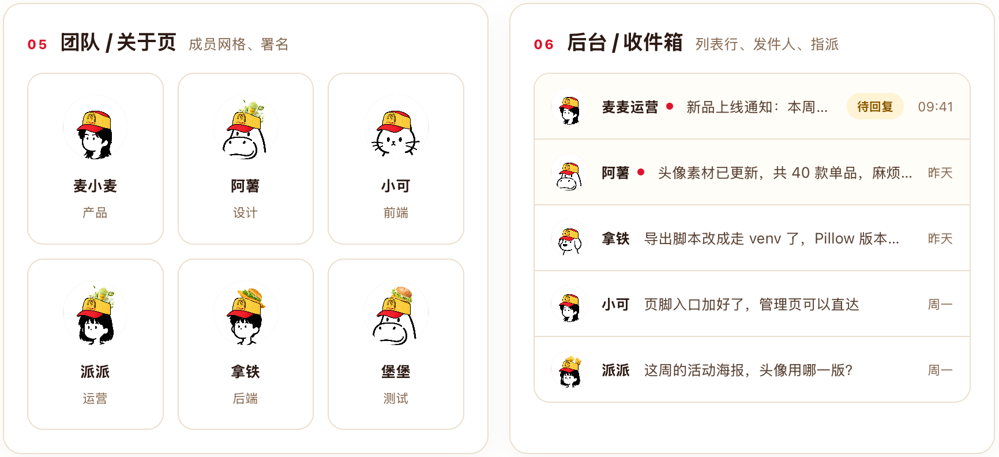
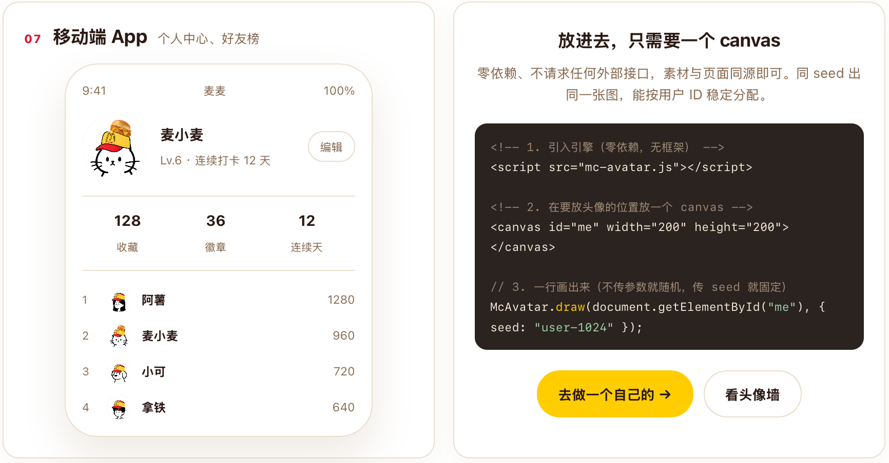
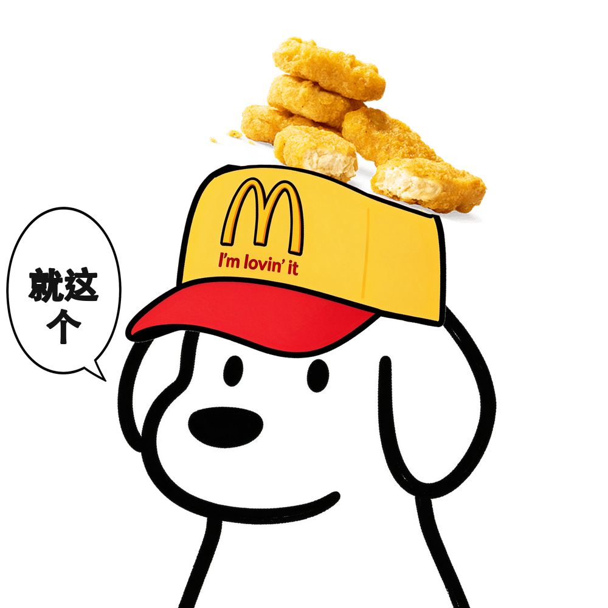

<p align="center">
  
</p>

<h1 align="center">今天什麦人</h1>

<p align="center"><b>让你的项目快速拥有麦当劳新品头像</b></p>

<p align="center">
  <a href="https://jerrytry.github.io/mcd-avatar/"><b>▶ 在线试玩</b></a>
  &nbsp;·&nbsp;
  <a href="https://jerrytry.github.io/mcd-avatar/avatar/wall.html">头像墙</a>
  &nbsp;·&nbsp;
  <a href="https://jerrytry.github.io/mcd-avatar/avatar/use-cases.html">能用在哪些地方</a>
</p>

<p align="center">
零依赖 · 一个 canvas 一行代码 · 按用户 ID 稳定生成 · 新品上架自动换新
</p>

---

> 一款**零依赖的头像引擎**：一段 `<script>`、一个 `<canvas>`、一行调用，就能给你的博客、
> 论坛、社区、后台、App 里每一位用户，配上一个「简笔画人物 + 麦麦帽 + 麦当劳新品」的头像。
> 菜单来自**麦当劳中国 MCP** 的真实数据 —— 麦当劳上新，头像跟着上新。

## ✨ 这是什么

两个目录，一条数据链：

```
麦当劳 MCP  ──→  mcp/  ──→  avatar/manifest.json  ──→  avatar/
（真实菜单）   采集·清洗·管菜品      上架单品清单        纯静态头像生成器
```

| 目录 | 角色 | 需要什么 |
| --- | --- | --- |
| **`avatar/`** | 头像生成器本体：单页应用 + 可嵌入 JS 引擎 | **零依赖、零后端**，把目录丢到任意静态托管就能用 |
| **`mcp/`** | 数据源：从麦当劳 MCP 拉最新菜单、决定哪些菜品能进头像 | Python + Pillow，只在更新菜单时才跑 |

这两个目录是**松耦合**的：`avatar/` 不跑 Python 也能工作（它只读 `manifest.json`），
`mcp/` 也不需要前端。但数据是单向流动的——头像里能选的每一口，都来自 MCP 的真实菜单。

## 🖼 看一眼

**整面墙都是现场合成的**，没有一张图是提前画好的 —— 7 个角色 × 250 款真实菜单 × 麦麦帽，
刷新一次换一批：



**放进任何有头像的地方，就是这种感觉：**

*01 博客 / 独立站 · 02 论坛 / 社区* — 作者卡、评论区、楼层、在线成员


*03 聊天 / 社交软件 · 04 社交动态* — 会话列表、气泡、群成员、点赞头像堆叠


*05 团队 / 关于页 · 06 后台 / 收件箱* — 成员网格、列表行、发件人


*07 移动端 App · 接入代码* — 个人中心、好友榜，以及把它放进你自己项目的那 4 行


## 🧑‍💻 目标用户

| 谁 | 拿去干什么 | 用哪部分 |
| --- | --- | --- |
| **想换个有梗头像的普通用户** | 打开网页，点一个「今天想吃的那口」，下载 PNG 换上 | `avatar/index.html`，零安装 |
| **做博客 / 论坛 / 社区 / 后台的开发** | 给自己的站点批量生成**零依赖、不请求外部接口**的随机头像，按用户 ID 稳定分配 | `avatar/mc-avatar.js` + `manifest.json` |
| **正在接 MCP 的开发者** | 看一个「把官方菜单数据变成可传播内容」的完整样例：采集 → 清洗 → 策展 → 出图 | `mcp/` 整条数据流水线 |
| **做运营 / 做物料的人** | 直接从头像墙上截图取材，或按需跑一批头像 | `avatar/wall.html`、`avatar/use-cases.html` |

一句话：**开发者要一个能嵌进自己项目的引擎，用户要一张能直接换上的图，MCP 玩家要一份可复现的数据流水线**——三者共用同一份数据、同一个「新品」。

## 🚀 快速开始

### ① 只想生成头像

```bash
cd avatar && python3 -m http.server 8777
# 浏览器打开 http://localhost:8777
```

7 个角色 × 上架在售单品，「只戴帽 / 帽+食物」两种模式、按名称搜索、按品类筛选、
聊天框文案、一键随机、Canvas 实时合成并下载 PNG。**不用装任何东西。**

同一个服务下还有两个宣传页：

| 页面 | 地址 | 作用 |
| --- | --- | --- |
| 随机头像墙 | `/avatar/wall.html` | 整屏平铺随机头像，一眼看清风格多样性，点「换一批」即重排 |
| 用在哪里 | `/avatar/use-cases.html` | 博客作者卡、论坛楼层、聊天软件、社交动态、团队页、后台邮件、移动端个人中心，七个真实界面位置实拍 |

### ② 嵌进自己的项目

把 `avatar/` 目录（至少 `mc-avatar.js` + `manifest.json` + `assets/`）原样放到你的站点，
然后三行调用：

```html
<script src="mc-avatar.js"></script>
<canvas id="avatar" width="1000" height="1000"></canvas>
<script>
  // 画到 canvas 上（页面里实时预览）
  McAvatar.draw(document.getElementById("avatar"), {
    mode: "with_food", person: "a1", code: "1401", bubble: "你懂的"
  });

  // 或者只要一张图，直接塞给  / 上传 / 存库
  const url = await McAvatar.toDataURL({ seed: 20261021 });   // 同 seed 出同一张
</script>
```

| 参数 | 说明 |
| --- | --- |
| `mode` | `"with_food"` 帽+食物 / `"hat_only"` 只戴帽；不传则随机 |
| `person` | 人物 id，如 `"a1"`；不传则随机 |
| `code` | 食物 code，如 `"1401"`（麦乐鸡）；不传则随机 |
| `bubble` | 聊天框文案，**固定取前三个字、一字一行竖排**；`""` 表示不显示；不传则随机 |
| `seed` | 数字或字符串，**同 seed 出同一张图**（适合按用户 ID 稳定分配） |
| `size` | 输出边长，默认 1000 |
| `manifest` | `manifest.json` 地址，默认同目录 |

还提供 `McAvatar.toBlob(opts)`、`McAvatar.list()`（可用角色/食物/文案）。

> ⚠️ 素材必须与页面**同源**，或托管方返回 CORS 头 —— 否则 canvas 被污染，
> `toDataURL` 会抛 `SecurityError`。最省事的做法就是把 `avatar/` 整个托管出去。

### ③ 更新麦当劳菜单（MCP 消费点）

菜单不是一次性爬完就写死的 —— 这是个可以随时跑的**更新功能**：

```bash
export MCDONALD_TOKEN="你的token"    # https://mcp.mcd.cn 申请
python3 mcp/update_menu.py           # 采集 → 清洗 → 下图 → 导出，一条命令
```

它会调 MCP 的 `query-nearby-stores` / `query-meals` / `query-meal-detail` /
`list-nutrition-foods`，跑完打印本次**新增 / 下线**的单品，并直接刷新 `avatar/manifest.json`。
不联网也能用已有原始响应重算：

```bash
python3 mcp/update_menu.py --skip-fetch
```

详见 [MCP_INTEGRATION.md](MCP_INTEGRATION.md)。

## 🍟 菜品管理：哪些单品能进头像

菜单 250 款，官方图已落本地 227 款。但里面混着三样不能上头像的东西：

- **套餐/组合装** —— 一托盘多件，摆到头顶看不出主体；
- **非餐品** —— 玩具、联名帽、酱料包、盲盒袋；
- **同名重复 SKU** —— 不同门店的近义条目，留一条就够。

所以「采集」和「上架」是两件事。上架状态直接写在数据源 `mcp/data/catalog.json` 的
`in_catalog` 字段里，**没有额外的清单文件**：

```bash
python3 mcp/manage.py --list                  # 全量菜单 + 上下架 + 建议
python3 mcp/manage.py --suggest               # 按规则重置（套餐/非餐品/重名自动排除）
python3 mcp/manage.py --off 9900004835,514850 # 下架
python3 mcp/manage.py --on 1401               # 加回
python3 mcp/export_avatar.py                  # 让头像端生效（图形界面保存时会自动跑）
```

图形界面（零依赖，带本地保存接口）：

```bash
python3 mcp/serve.py            # 在项目根目录起服务（默认 8777，可 --port 改端口）
# 打开 http://localhost:8777/mcp/manage.html
# 勾选 / 取消勾选后点「保存更改」，直接写回 catalog.json 并自动重新导出头像
```

> 注：`python3 -m http.server` 仍能用来只读浏览页面，但管理页的「保存」需要
> `mcp/serve.py` 提供的写接口（纯静态服务器无法接收页面提交的数据）。

> **下架不删数据**：条目和官方图全部保留，`--on` 加回来重跑导出就恢复。

## 🛠️ 环境准备（只有 mcp/ 需要）

```bash
python3 -m venv .venv && source .venv/bin/activate
pip install -r requirements.txt   # 仅 Pillow；avatar/ 零依赖
```

维护、数据流水线与排错见 [ONBOARDING.md](ONBOARDING.md)。

## 📦 目录结构

```
.
├── avatar/                     ★ 纯静态头像生成器（可单独部署）
│   ├── index.html              单页应用
│   ├── mc-avatar.js            ★ 合成引擎 + 可嵌入 API
│   ├── app.js                  页面交互层（只调引擎，不含绘制逻辑）
│   ├── style.css
│   ├── wall.html               宣传页①：随机头像平铺墙
│   ├── use-cases.html          宣传页②：7 个真实界面使用场景
│   ├── promo.js                宣传页批量渲染（canvas[data-avatar]，零依赖）
│   ├── promo.css               宣传页共用样式
│   ├── manifest.json           导出产物：人物 + 帽子 + 上架单品清单
│   └── assets/
│       ├── persons/ a1~a7      人物
│       ├── hats/ h1 h2 chat2   普通帽 / 顶食帽 / 聊天框
│       └── foods/              上架单品的官方图（脚本生成）
├── mcp/                        ★ 数据源与菜品管理（Python）
│   ├── update_menu.py          [更新菜单] 采集 → 清洗 → 下图 → 导出
│   ├── mcp_client.py           麦当劳 MCP 客户端（无会话 / 双格式 / 混合文本）
│   ├── fetch_full.py           [采集] 多城门店 → 菜单 → 拆套餐子单品
│   ├── fetch_images.py         [采集] 官方产品图 → assets/img/
│   ├── merge_full.py           [清洗] 合并去重 + 营养对齐 → data/catalog.json
│   ├── clean_products.py       [清洗] 名称归一化 / 营养解析 / 品类归类 / 策展规则
│   ├── manage.py               [管理] 菜品上下架（改 catalog.in_catalog）
│   ├── export_avatar.py        [导出] 上架单品 + manifest → avatar/
│   ├── serve.py                本地开发服务（静态 + 保存接口，零依赖）
│   ├── manage.html + manage.js 菜品管理页（点「保存更改」写回，需 serve.py）
│   ├── data/
│   │   ├── catalog.json        ★ 唯一数据源：全量菜单 + 上下架 + 本地图
│   │   └── raw/                MCP 原始响应（可离线重算，已 gitignore）
│   └── assets/img/             227 张官方产品原图
├── tools/                      本地验证工具（非产品运行时）
│   ├── preview.py              命令行出图（Pillow，验证几何参数）
│   └── check.py                自检：数据 / 产物 / 素材 / 出图一致性
├── docs/                       宣传图（logo / 头像墙 / 使用场景截图）
├── output/                     本地出图产物（已 gitignore）
├── MCP_INTEGRATION.md          MCP 调用链说明
├── CONTEST_DECLARATION.md      参赛声明（官方模板，内容不可改）
├── mcp-config.example.json     脱敏 MCP 配置示例
├── workbuddy.md                WorkBuddy 开发上下文（专项奖核验）
├── ONBOARDING.md               维护与数据手册
├── requirements.txt            Python 依赖（Pillow）
└── .env.example                MCP Token 配置模板
```

## 🎨 合成逻辑

单张成品长这样（人物 + 麦麦帽 + 麦当劳鸡块 + 三字气泡，全部现场合成）：



头像由四层叠加而成（`avatar/assets/` 素材约定：`a*`=人物、`h1`=普通帽、`h2`=顶食帽、`chat2`=气泡）：

| 模式 | 组合 |
| --- | --- |
| 只戴帽 | 人物 + h1 |
| 帽 + 食物 | 人物 + h2 + 麦当劳食物**官方原图**（坐在帽子右上方）|

关键工程点（`avatar/mc-avatar.js` 与 `tools/preview.py` 两端一致）：

- **自动检测头顶** —— 扫描每个人物图像中央列最高像素，不同头型（女孩/河马/猫）都能对准；
- **人物自适应对齐** —— 等比缩放 + 平移把头顶统一到画布 y=400，上方留足空间放帽+食物；
- **食物防出界** —— 以帽顶为基准向上放置，竖高食物（杯子）按可用空间自动缩小，绝不超出顶部或遮挡脸部；
- **Z 轴叠放** —— 先画食物再画帽子，食物坐在帽子下层、从帽沿右上方探出；
- **气泡智能避让** —— 聊天框宽度按人物内容最左边缘自适应，任何角色都不压头；文案固定三字、一字一行竖排居中；
- **基于 alpha 包围盒** —— 自动裁掉素材四周透明边，贴合精准。

## 🔧 技术栈

- **数据采集**：麦当劳中国 MCP Server（Streamable HTTP / JSON-RPC 2.0）
- **合成引擎**：原生 JS + Canvas（零依赖，可嵌入）
- **数据清洗 / 出图校验**：Python + Pillow

## ⚠️ 免责声明

本项目为麦当劳程序员节创意开发大赛参赛作品，由参赛者独立开发，**非麦当劳官方产品**。
所有产品图片版权归麦当劳所有，仅用于技术演示。餐品信息、价格及供应状态以麦当劳官方渠道实时结果为准。
